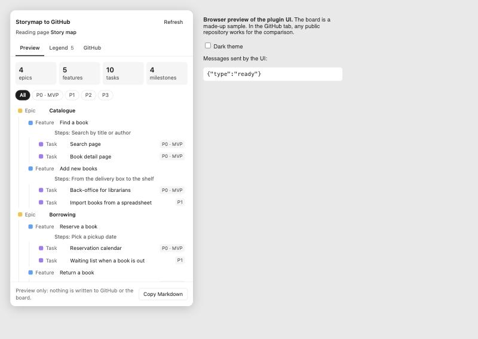

# Storymap to GitHub

A FigJam plugin that reads a user story map as the GitHub backlog it is, or will become: epics, features with their steps, tasks and milestones. The map and the plugin window answer each other: hover a row to find its sticky, click a sticky to open its card. It shows where the map and GitHub disagree, can put a small label on each linked sticky, and, once the team allows it, publishes a sticky as an issue from its card.



## Why

Product owners plan in FigJam, developers work in GitHub Issues and Projects, and someone retypes the map by hand. The tools that exist turn one sticky into one issue. This one reads the map as a whole: rows or colours give the kind of item, columns give the parent, release rows give the milestone.

## How it reads a board

Two conventions, chosen automatically and switchable in the Legend tab:

- **By rows**, as in [Figma's story map template](https://www.figma.com/templates/story-map-example/): labelled rows give the kind of every sticky in them. By default User Persona becomes a note, Activities epics, Tasks features, and each Release row a milestone holding its tasks. Each row's meaning can be changed. Rows are picked automatically when the row labels are about as tall as a sticky, as in the template.
- **By colours**, as many team boards do: each sticky colour gives the kind of item. The rules below apply.

The plugin reads the whole current page and needs edit access to the file: Figma does not run plugins in view-only files.

- **Colours.** By default, after Jeff Patton's story map: yellow epics, blue activities (features), green steps, violet tasks, pink notes for the product owners. The Legend tab lists every colour found and lets you change what each one means.
- **Columns.** A feature belongs to the nearest epic at or left of it, a step to the nearest feature, a task to the column it overlaps most.
- **Arrows.** An arrow between a task and a feature, step or epic sets the task's parent, whatever the column. An arrow between two tasks makes the lower one a sub-task.
- **Releases.** A section named like a release (`P0`, `MVP`, `Release 1`, `R2`, `v1`, `Sprint 3`) holds its tasks. Otherwise short release tags (`P0`, `MVP`, any colour) label rows, and long horizontal lines, when the board has them, mark where each row starts and ends.
- **Legend.** A section named `Legend`, and stickies that explain the colours ("Epics and targets", "Steps: …"), are skipped. The Legend tab says what was read on the page.

## Linking stickies and issues

In the GitHub tab, press **Connect with GitHub**: the plugin shows a short code, opens GitHub, and is connected once you authorize it there. Then pick the repository from your list, and its project board. Each FigJam file keeps its own repository and project board, so a copy of a board can be connected to a test repository while the original stays on the real one. Items whose title matches an issue (case, accents, `Epic:` prefixes and small words ignored) are linked. For the others, click the sticky on the board: its card shows the three issues it most likely is, with the words they share, a search box, and "Not on GitHub yet". Links are saved in the file, on each sticky and for each repository, so everyone working on the board sees the same ones.

**Publishing a sticky.** The card of a sticky that is not on GitHub yet shows the issue it would become: its title, which you can edit, its type, its parent, its milestone from the release row, its labels, and its status on the project board. Then "Create the issue" creates it, makes it a sub-issue of its parent, adds it to the board and links the sticky. Nothing is written until the team turns on "Allow changes to owner/repo" in the GitHub tab, which is off for every repository by default. The label and status a new issue starts with are set there too, for each repository (by default `needs-refinement` and `Backlog`). If the owner has no issue type for an epic, feature or task, a label of that name stands in for it. A sticky whose parent is not on GitHub yet is published without a parent, and the preview says so.

**What moved this week.** In Differences, "Start the week now" (at the weekly, for example) keeps a snapshot of the issues in the file. From then on, the section lists the issues created, closed, reopened or changed since, field by field (title, milestone, status, sprint, size, assignees), for everyone on the board. GitHub's issue history does not record changes made on a project board, which is why the plugin compares against its own snapshot. "Start a new week" moves the starting point.

**Publishing a batch.** In Differences, "On the map only" lists the stickies with no issue, each with a box to tick. Nothing is ticked at first; "Tick the new ones" ticks every sticky that looks like no existing issue, and the ones marked `#19?` should be linked from their card instead. "Create N issues" creates them parents first, so a feature lands under its new epic and a sub-task under its new task, and reads GitHub once at the end.

**Labels on the board.** Once a repository is compared, the "Labels on the board" switch puts a small locked label in the corner of every linked sticky, such as `#19 · Sprint 1 · Ready`. Labels follow their sticky when it moves, are updated on every read, and all go away when the switch is turned off. Labels and links are written on the board only.

## Drift: where the map and GitHub disagree

The Drift tab lists where the plan and the work no longer say the same thing: a task in another release row than its milestone, an issue under another parent than on the map, a renamed issue, an issue closed as not planned while the map still has it. It also counts the stickies with no issue and lists the open issues that are not on the map.

**Sprints.** Name the GitHub Projects board in the GitHub tab to read each issue's sprint, status and size. Tasks then carry their sprint, the preview filters by sprint, and Drift flags a task whose sprint ends after the due date of its release on the map. The board is listed once you are connected.

**Why?** reads the issue's history on GitHub and says who changed what, and when ("2026-11-05, @someone set the milestone to P0").

**Settling a difference.** Each one offers its choices, and nothing changes until one is picked: the map is right (the plugin renames the issue, sets its milestone from the release row, or moves it under the parent on the map), GitHub is right (for a title, the sticky takes the issue's title), or keep both, which hides the difference for the whole team until either side changes again. Changing GitHub needs the plugin to be allowed to write to the repository.

## Try it

You need Node.js 22 and the Figma desktop app; development plugins do not load in the browser.

```bash
npm install
npm run build
```

Then in FigJam: Plugins, Development, Import plugin from manifest, and pick the `manifest.json` the build wrote. Open the page that holds your story map and run Storymap to GitHub.

## Signing in

GitHub's device flow signs people in without a password or a secret in the plugin. GitHub's sign-in endpoints refuse calls from a browser window, so two calls go through a small Cloudflare Worker, [relay/index.js](relay/index.js), which keeps nothing: no secret, no token, no log. The client id and the scopes (`repo project read:org`) are set in the relay, not by the caller. Deploy it with `npx wrangler deploy --config relay/wrangler.jsonc`. A classic token can still be pasted instead.

## Try it on a copy

Try the plugin on a copy of the FigJam board, and, before anything writes to GitHub, on a copy of the repository. These scripts build a private copy of a real backlog: labels, milestones, issues with the same numbers, sub-issues, and a project board with the same statuses, sizes and sprints. They only read the source and only write to the copy.

```bash
node scripts/make-sandbox.mjs owner/repo https://github.com/orgs/owner/projects/12 your-org/repo-sandbox
node scripts/finish-sandbox.mjs owner/repo https://github.com/orgs/owner/projects/12 your-org/repo-sandbox
node scripts/check-sandbox.mjs owner/repo https://github.com/orgs/owner/projects/12 your-org/repo-sandbox https://github.com/orgs/your-org/projects/N
```

Mentions in the copied issues are broken so nobody is notified. If the copy's organisation has no Epic issue type, epics get an `epic` label instead.

## Develop

Built with [Create Figma Plugin](https://yuanqing.github.io/create-figma-plugin/), following its Preact template: `src/main.ts` is the plugin code, `src/ui.tsx` the window, with Create Figma Plugin's Preact components. The board reading logic is in `src/core.js`, free of any Figma API, typed in `src/core.d.ts`, and tested with Node's test runner.

```bash
npm test
npm run watch
```

## Status

Reads, links, compares, labels, and publishes one sticky at a time. Next: publishing several stickies at once after a review list, and a real "Sign in with GitHub" instead of a token.

## License

MIT
