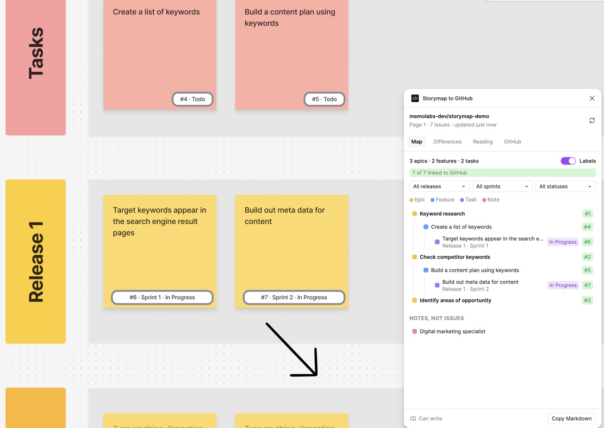

# Storymap to GitHub

A FigJam plugin for teams that plan in a story map and build in GitHub. It reads the map as the backlog it is, or will become: epics, features with their steps, tasks, releases. Then it keeps the two in step, from the board: create the issues, see where the map and GitHub disagree, settle it in one click, and see what moved this week.



## Why

Product managers plan in FigJam. Developers work in GitHub Issues and Projects. In between, someone retypes the map, and a week later the two say different things. The tools that exist turn one sticky into one issue. This one reads the map as a whole: rows or colours give the kind of item, columns give the parent, release rows give the milestone.

## What it does

- **Reads your board** the way your team lays it out: by rows, as in Figma's story map template, or by sticky colours. Each row or colour can be given another meaning.
- **Links stickies to issues.** Identical titles are linked at once; for the others, the sticky's card shows the three likeliest issues.
- **Creates issues from the map**, one at a time or in a batch, with a preview: the user story and acceptance criteria, the type, the parent as a sub-issue, the milestone from the release row, the project board and its starting status. The text starts from the repository's own issue template when it has one.
- **Starts a story as a draft on the project board**, the product manager's default, and converts it into an issue when it is ready.
- **Shows the differences** (a renamed issue, another milestone, another parent, a sprint that ends too late, an issue dropped on GitHub) and settles each one: the map is right, GitHub is right, or keep both.
- **Shows what moved this week**, field by field, including the project board's status, sprint and size.
- **Puts a label on each linked sticky**, such as `#19 · Sprint 1 · Ready`, that follows the sticky on the board.
- **Keeps each role to its fields**: the product manager, the tech lead, or everyone, with a split the team sets.
- **Starts a new map** from Figma's story map rows on an empty page.

Nothing is written to GitHub until you click, and only in repositories where the team allowed it.

## Docs

- [Install](docs/install.md): add the plugin, connect GitHub, and what is kept where.
- [Guide](docs/guide.md): every tab and every action.
- [User stories](docs/user-stories.md): what a product manager needs, and where each story stands.
- En français : [installation](docs/fr/installation.md) et [guide](docs/fr/guide.md). The plugin itself speaks English and French.

## Try it on a copy

Try the plugin on a copy of the FigJam board, and, before anything writes to GitHub, on a copy of the repository. These scripts build a private copy of a real backlog: labels, milestones, issues with the same numbers, sub-issues, and a project board with the same statuses, sizes and sprints. They only read the source and only write to the copy.

```bash
node scripts/make-sandbox.mjs owner/repo https://github.com/orgs/owner/projects/12 your-org/repo-sandbox
node scripts/finish-sandbox.mjs owner/repo https://github.com/orgs/owner/projects/12 your-org/repo-sandbox
node scripts/check-sandbox.mjs owner/repo https://github.com/orgs/owner/projects/12 your-org/repo-sandbox https://github.com/orgs/your-org/projects/N
```

Mentions in the copied issues are broken so nobody is notified. If the copy's organization has no Epic issue type, epics get an `epic` label instead.

## Develop

Built with [Create Figma Plugin](https://yuanqing.github.io/create-figma-plugin/) and Preact. `src/main.ts` runs in Figma, `src/ui.tsx` is the window, and the logic that reads a board and compares it with GitHub is in `src/core.js`, free of any Figma API and tested with Node's test runner. Signing in goes through a small Cloudflare Worker in `relay/`. Details in [Install](docs/install.md#for-the-maintainer).

```bash
npm install
npm test
npm run watch
```

## Status

Works end to end on a copy of a real board and a test repository: reading, linking, creating issues, settling differences, the weekly view, roles and the starting template. Not yet published on Figma Community, so for now each person adds it as a development plugin. Dark theme not checked yet.

## License

MIT
