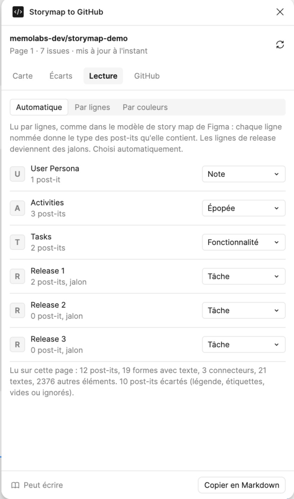
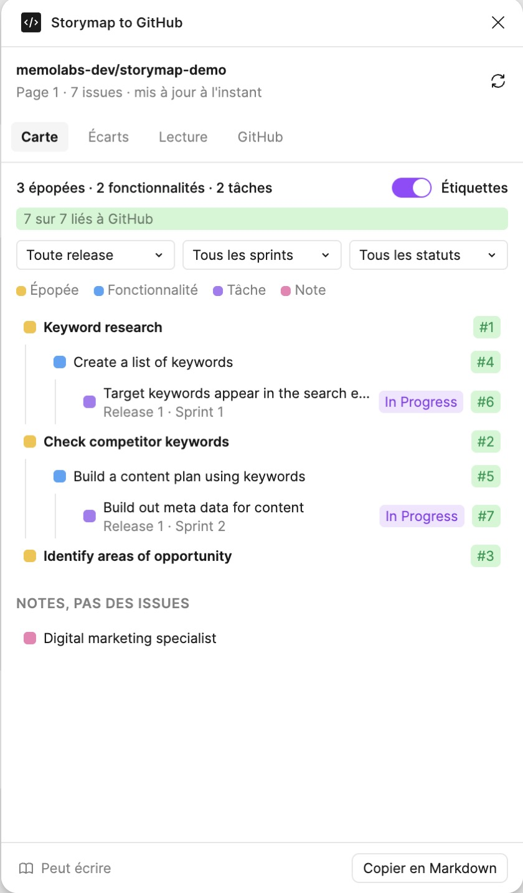
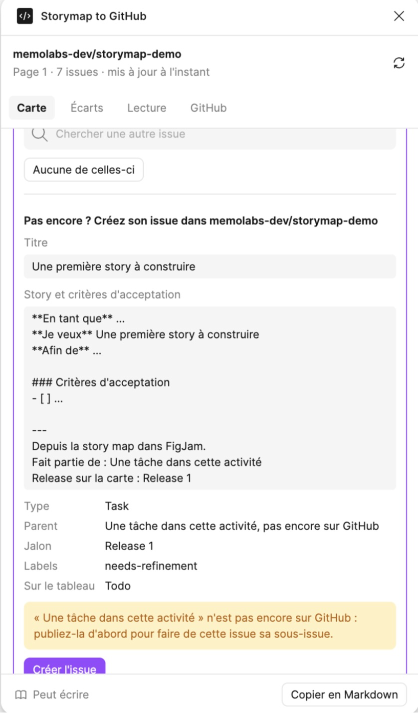

# Utiliser Storymap to GitHub

Le plugin se place à côté de votre story map dans FigJam. Il lit la carte, montre le backlog GitHub qu'elle est ou qu'elle deviendra, et vous laisse agir sur GitHub depuis le tableau. Rien n'est écrit sur GitHub avant votre clic, et seulement là où l'équipe l'a autorisé.

Installer le plugin et connecter GitHub : voir [installation.md](installation.md). [English version](../guide.md)

## Les quatre onglets

- **Carte** : la carte vue comme un backlog, et la fiche du post-it sélectionné.
- **Écarts** : là où la carte et GitHub ne disent plus la même chose, ce qui a bougé cette semaine, et les post-its qui n'ont pas encore d'issue.
- **Lecture** : comment le plugin lit votre tableau.
- **GitHub** : votre compte, le dépôt, le tableau de projet, votre rôle, et ce que le plugin a le droit de faire.

L'en-tête indique le dépôt connecté, la page lue et quand GitHub a été relu. La flèche ronde relit le tableau et GitHub.

## Pour commencer

Un petit guide reste en haut de l'onglet Carte tant que chaque étape n'est pas faite : vérifier la lecture du tableau, connecter GitHub, lier un premier post-it, afficher les étiquettes sur le tableau. Il montre une étape à la fois et disparaît quand les quatre sont faites. La croix le masque ; le bouton **Guide** de l'en-tête le fait revenir.

## Comment le tableau est lu

Le plugin connaît deux façons de disposer une story map, et choisit tout seul :

- **Par lignes**, comme dans le modèle de story map de Figma. Chaque ligne étiquetée donne le type des post-its qu'elle contient : User Persona devient des notes, Activities des épopées, Tasks des fonctionnalités, et chaque ligne Release un jalon qui contient ses tâches.
- **Par couleurs**, comme sur beaucoup de tableaux d'équipe. Chaque couleur de post-it donne un type : par défaut jaune pour les épopées, bleu pour les fonctionnalités, vert pour les étapes, violet pour les tâches et rose pour les notes.

L'onglet Lecture montre ce qui a été trouvé et permet de le changer : forcer les lignes ou les couleurs, changer le sens d'une ligne ou d'une couleur. Une section nommée `Legend`, et les post-its qui expliquent les couleurs, sont ignorés. Une fonctionnalité appartient à l'épopée la plus proche, au-dessus ou à sa gauche ; une tâche, à la colonne qu'elle recouvre le plus. Une flèche entre deux post-its fixe le parent, quelle que soit la colonne.

## La carte

L'arbre montre les épopées, les fonctionnalités avec leurs étapes, les tâches et les sous-tâches. Chaque ligne porte une pastille :

- `#19` en vert : liée à l'issue 19.
- `#19?` en orange : l'issue 19 a un titre proche. Ouvrez la fiche pour confirmer ou en choisir une autre.
- `Nouveau` : pas encore sur GitHub.

Une tâche liée affiche aussi son **sprint** et son **statut**, c'est-à-dire sa colonne sur le tableau de projet : `Ready`, `In progress`, `In review`, `Done`, avec les noms exacts de votre tableau. Une issue fermée est marquée **Fermée**.

Survoler une ligne sélectionne son post-it sur le tableau ; cliquer zoome dessus et ouvre sa fiche. Au-dessus de l'arbre : les totaux, la part de post-its liés, et des filtres par release, par sprint et par statut.

**Étiquettes sur le tableau.** L'interrupteur **Étiquettes** pose une petite étiquette dans le coin de chaque post-it lié, par exemple `#19 · Sprint 1 · Ready`. Elle suit son post-it quand il bouge et change quand l'issue change.

## La fiche d'un post-it

Cliquez sur un post-it du tableau, ou sur une ligne de l'arbre : sa fiche s'ouvre en haut de l'onglet Carte.

**Déjà sur GitHub ? Choisissez son issue.** La fiche propose les trois issues les plus probables, avec les mots en commun, et une recherche. Cliquez sur l'une pour la lier. **Aucune de celles-ci** marque le post-it comme pas encore sur GitHub. Une fiche liée affiche le statut de l'issue, son sprint, sa taille et qui est dessus ; **Pas cette issue** retire le lien. Les liens sont gardés dans le fichier : toute l'équipe voit les mêmes.

**Pas encore ? Créez son issue.** La fiche montre l'issue avant que rien ne soit écrit :

- **Titre**, repris du post-it, modifiable.
- **Story et critères d'acceptation** : le texte de l'issue, prérempli avec le modèle du dépôt (en tant que, je veux, afin de, critères d'acceptation, puis la place du post-it sur la carte). Écrivez la story ici.
- **Type, parent, jalon, labels, statut sur le tableau.** Le type est le type d'issue de GitHub si l'organisation l'a, sinon un label du même nom. Le parent est l'épopée ou la fonctionnalité du post-it, si elle est déjà sur GitHub. Le jalon vient de la ligne de release.

**Créer l'issue** la crée, en fait une sous-issue de son parent, l'ajoute au tableau de projet avec son statut de départ, et lie le post-it.

**Taille.** Sur un post-it lié, la ligne **Taille** pose la taille de l'issue sur le tableau de projet, ou l'efface.

## Publier un lot

Dans **Écarts**, ouvrez **Seulement sur la carte** : tous les post-its sans issue, chacun avec une case à cocher. Rien n'est coché au départ. **Cocher les nouveaux** coche tous ceux qui ne ressemblent à aucune issue existante ; ceux marqués `#19?` ressemblent à une issue qui existe, alors ouvrez leur fiche et liez-les plutôt. **Créer N issues** les crée en commençant par les parents : une nouvelle fonctionnalité arrive sous sa nouvelle épopée, une sous-tâche sous sa nouvelle tâche.

## Les écarts

Quand un post-it lié et son issue ne disent plus la même chose, l'onglet Écarts dit en quoi :

- **Titre** : l'issue a été renommée, ou le post-it.
- **Jalon** : la tâche est dans une autre ligne de release que son jalon.
- **Parent** : l'issue est sous un autre parent que sur la carte.
- **Prévue trop tard** : le sprint de l'issue finit après l'échéance de sa release.
- **Abandonnée sur GitHub** : l'issue a été fermée comme non prévue, mais la carte l'a encore.

**Pourquoi ?** lit l'historique de l'issue et dit qui a changé quoi, et quand.

Chaque écart propose ses choix, et rien ne change tant que vous n'en avez pas choisi un :

- **La carte a raison** : renommer l'issue, mettre son jalon, ou la ranger sous le parent de la carte.
- **Renommer le post-it**, pour un titre, quand GitHub a raison.
- **Garder les deux** : masquer l'écart pour toute l'équipe, jusqu'à ce que l'un des deux côtés change encore.

L'onglet liste aussi les titres proches à confirmer, les post-its sans issue, et les issues ouvertes qui ne sont pas sur la carte.

## Ce qui a bougé cette semaine

Au point de la semaine, cliquez sur **Démarrer la semaine** dans Écarts. Le plugin garde une photo des issues dans le fichier. Ensuite, la section liste les issues créées, fermées, rouvertes ou modifiées, champ par champ : titre, jalon, statut, sprint, taille, personnes assignées. **Nouvelle semaine** déplace le point de départ.

L'historique de GitHub n'enregistre pas les changements faits sur un tableau de projet, comme un statut ou un sprint : c'est pourquoi le plugin compare à sa propre photo.

## Les rôles

Dans l'onglet GitHub, chaque personne choisit un rôle : **Product manager**, **Tech lead** ou **Tout le monde**. Le plugin ne propose alors que les changements de ce rôle, et dit à qui demander les autres.

Qui fait quoi est un réglage de toute l'équipe, dans **Plus de réglages**. Par défaut, le product manager crée les issues et pose les tailles, les titres et les jalons ; le tech lead range les issues sous un parent. Les rôles évitent de modifier par erreur le champ de quelqu'un d'autre ; ce n'est pas une sécurité.

## Plus de réglages

Dans **Plus de réglages**, onglet GitHub :

- **Langue** : automatique, anglais ou français, pour vous.
- **Qui fait quoi**, pour toute l'équipe.
- **Le label d'une nouvelle issue**, `needs-refinement` par défaut, vide pour aucun.
- **Le statut d'une nouvelle issue** sur le tableau de projet ; vide, c'est le premier statut du tableau.
- **Le texte d'une nouvelle issue**, où `{title}`, `{parent}`, `{release}` et `{steps}` sont remplis.

## Bon à savoir

- **La liste des issues de GitHub peut avoir une minute de retard.** Une issue que le plugin vient de créer ou de changer s'affiche tout de suite ; un changement fait sur GitHub lui-même peut mettre une minute à apparaître après une relecture.
- **Copier en Markdown**, en bas, copie le backlog comme une liste de cases à cocher, à coller dans une issue ou une note.
- **L'offre gratuite de Figma** permet une page par fichier FigJam, et trois fichiers.
