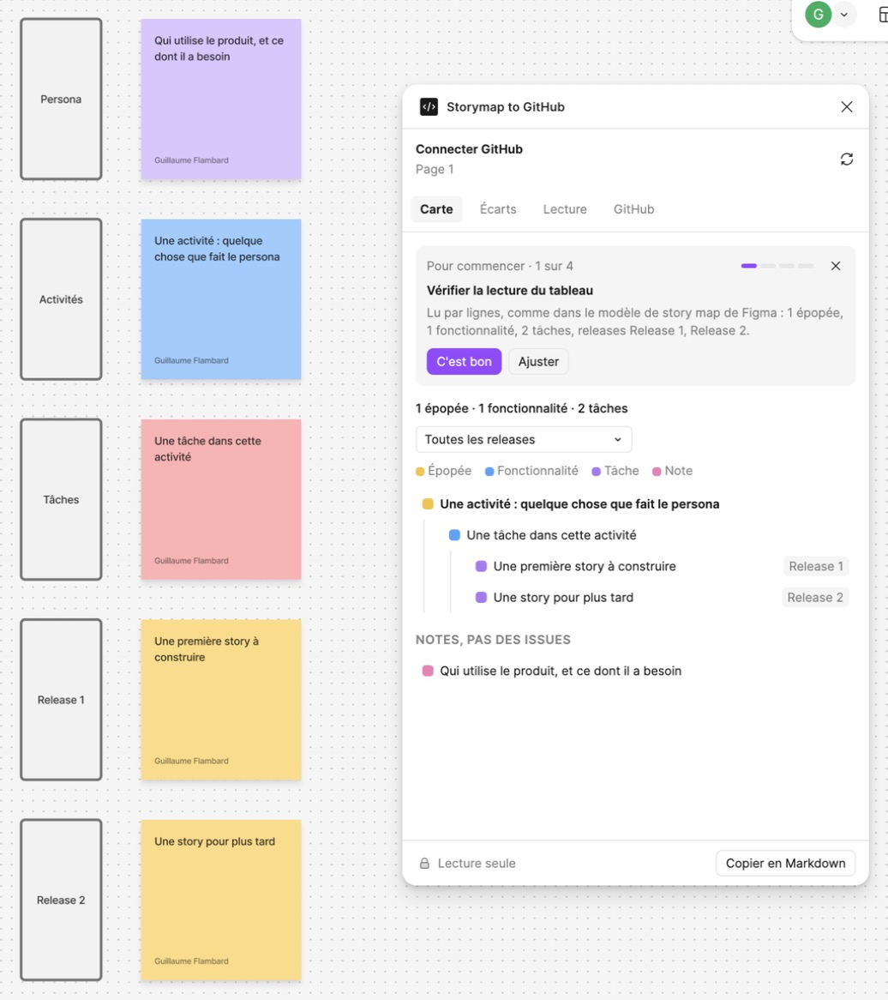
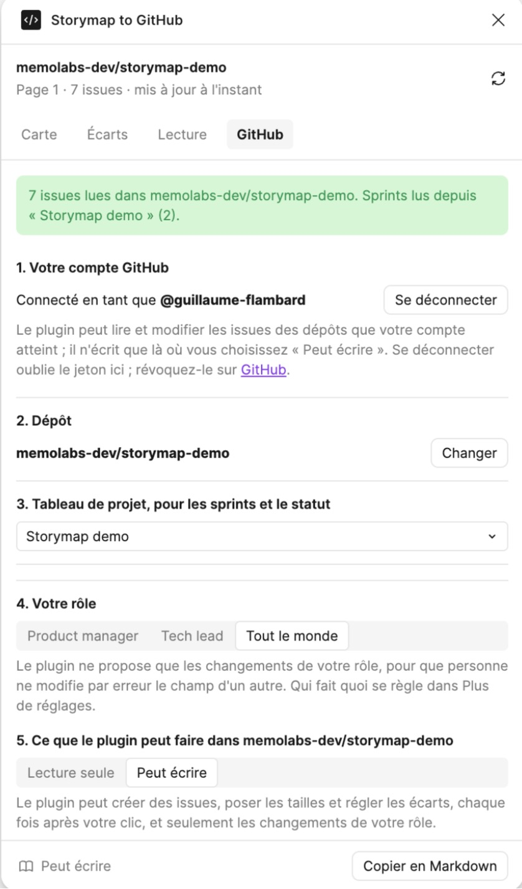

# Installer Storymap to GitHub

Deux parties : faire tourner le plugin pour votre équipe, puis ce que doit savoir la personne qui le maintient.

[English version](../install.md)

## Pour une équipe

### Ce qu'il faut

- L'**application Figma pour ordinateur**. Les plugins de développement ne tournent pas dans le navigateur.
- Les **droits d'édition** sur le fichier FigJam. Figma ne lance pas de plugin dans un fichier en lecture seule.
- Un **compte GitHub** qui voit le dépôt. Pour créer des issues depuis le plugin, il faut aussi le droit d'écrire dans ce dépôt.

### 1. Ajouter le plugin à Figma

Le plugin n'est pas encore sur Figma Community. Pour l'instant, on l'ajoute comme plugin de développement, à partir de son code. Chaque personne qui l'utilise le fait une fois.

Il faut [Node.js 22](https://nodejs.org/) et l'accès à ce dépôt.

```bash
git clone https://github.com/memolabs-dev/storymap-to-github.git
cd storymap-to-github
npm install
npm run build
```

Puis, dans l'application Figma, ouvrez un fichier FigJam et choisissez **Plugins › Development › Import plugin from manifest…**. Prenez le fichier `manifest.json` que la construction a écrit à la racine du dossier.

Un plugin de développement n'apparaît que pour la personne qui l'a importé. Cette étape disparaîtra quand le plugin sera publié.

### 2. L'ouvrir sur votre story map

Ouvrez la page qui contient votre story map, puis **Plugins › Development › Storymap to GitHub**. Le plus rapide : `Cmd /`, tapez `Storymap`, puis Entrée.

Le plugin s'affiche dans la langue de votre système, en français ou en anglais. Pour en changer : onglet **GitHub**, **Plus de réglages**, **Langue**.

Sur une page vide, le plugin propose **Ajouter un modèle de story map** : les lignes du modèle de story map de Figma (User Persona, Activities, Tasks, Release 1, Release 2), chacune avec un post-it d'exemple.



### 3. Connecter GitHub

Dans l'onglet **GitHub** :

1. **Se connecter avec GitHub.** Le plugin affiche un code court. Cliquez sur **Copier le code et ouvrir GitHub**, collez le code sur la page qui s'ouvre et autorisez **Storymap to GitHub**. Le plugin est connecté quelques secondes plus tard.
2. **Dépôt.** Choisissez-le dans la liste des dépôts que votre compte voit, avec une recherche.
3. **Tableau de projet.** Choisissez le tableau GitHub Projects qui porte vos sprints, vos tailles et vos statuts. Si le dépôt n'en a qu'un, il est choisi pour vous.
4. **Votre rôle.** Product manager, tech lead ou tout le monde. Le plugin ne propose alors que les changements de votre rôle.
5. **Lecture seule ou Peut écrire.** Chaque dépôt démarre en lecture seule. Choisissez **Peut écrire** quand vous voulez créer des issues, poser des tailles ou régler des écarts depuis le plugin.



**Si votre organisation limite les OAuth Apps**, GitHub demande à un owner de l'organisation d'approuver Storymap to GitHub avant que le plugin puisse voir ses dépôts privés. L'owner le fait dans les réglages de l'organisation, rubrique **Third-party access**.

**Vous préférez un jeton ?** Sous **Se connecter avec GitHub**, choisissez **Utiliser un jeton à la place** et collez un jeton classique avec les droits `repo`, `project` et `read:org`.

### Ce qui est gardé, et où

| Quoi | Où | Qui le voit |
|---|---|---|
| Votre jeton GitHub, votre rôle, votre langue | Le stockage de Figma sur votre ordinateur | Vous seul |
| Le dépôt et le tableau d'un fichier | Le stockage de Figma sur votre ordinateur, par fichier | Vous seul |
| Les liens entre post-its et issues, les écarts gardés, le début de la semaine, qui fait quoi | Dans le fichier FigJam | Toute personne sur le tableau |

Se déconnecter oublie le jeton sur votre ordinateur. Il reste valable sur GitHub tant que vous ne l'avez pas révoqué dans les [réglages d'applications de GitHub](https://github.com/settings/applications).

### Essayer sans risque

Essayez d'abord sur une copie de votre tableau et une copie de votre dépôt. Les scripts `scripts/make-sandbox.mjs`, `finish-sandbox.mjs` et `check-sandbox.mjs` construisent une copie privée d'un vrai backlog : issues aux mêmes numéros, jalons, labels, sous-issues, et un tableau de projet avec les mêmes statuts, tailles et sprints. Ils ne font que lire la source. Le mode d'emploi est dans le [README](../../README.md#try-it-on-a-copy).

## Pour la personne qui maintient le plugin

### Le relais de connexion

Les adresses de connexion de GitHub pour le device flow (`github.com/login/device/code` et `github.com/login/oauth/access_token`) n'envoient pas d'en-têtes CORS : un plugin Figma ne peut pas les appeler depuis sa fenêtre. Le relais, dans [`relay/`](../../relay/index.js), est un Cloudflare Worker qui fait suivre ces deux appels et ajoute les en-têtes. Il ne garde rien : ni secret (le device flow n'en a pas besoin), ni jeton, ni journal. L'identifiant de l'app et les droits demandés sont fixés dans le relais, pas par l'appelant.

Il tourne à `https://storymap-auth.storymap-authmemolabsworkersdev.workers.dev`. Pour déployer une modification :

```bash
npx wrangler login
npx wrangler deploy --config relay/wrangler.jsonc
```

Si l'adresse change, mettez à jour `RELAY` dans `src/main.ts` et `networkAccess.allowedDomains` dans `package.json`, puis reconstruisez.

### L'OAuth App GitHub

**Storymap to GitHub** est une OAuth App de l'organisation `memolabs-dev`, avec le **Device Flow** activé. Son identifiant (client id) est public et inscrit dans `relay/wrangler.jsonc`. Elle n'a pas de secret, et n'en a pas besoin.

### Développer

```bash
npm test        # la lecture du tableau, les traductions et le relais, avec le lanceur de tests de Node
npm run watch   # reconstruit à chaque changement ; Figma recharge le plugin
npm run build   # vérifie les types et construit dans build/
```

Le plugin suit le modèle Preact de Create Figma Plugin : `src/main.ts` tourne dans Figma, `src/ui.tsx` est la fenêtre. La logique qui lit un tableau et le compare à GitHub est dans `src/core.js`, sans aucune API Figma. Les textes sont dans `src/i18n.js`, en anglais et en français.
