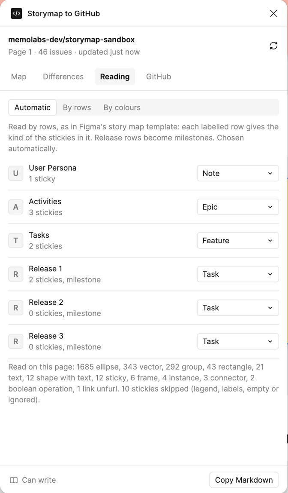
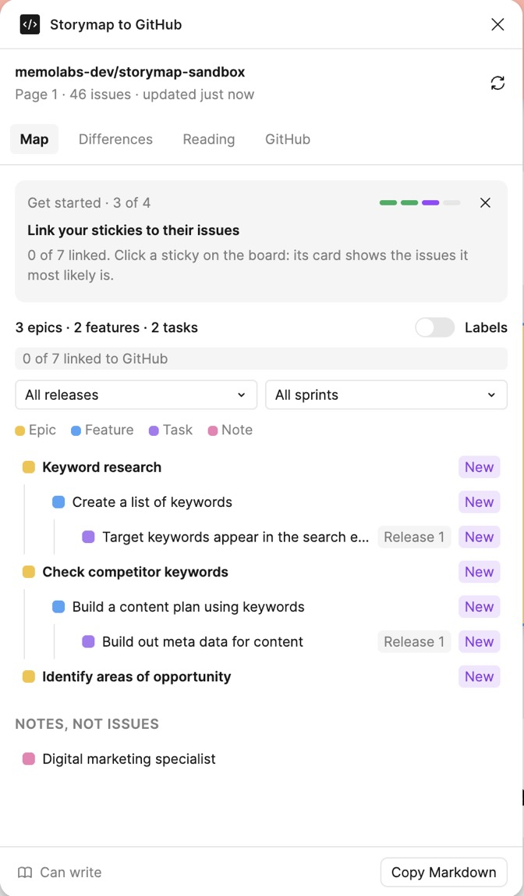
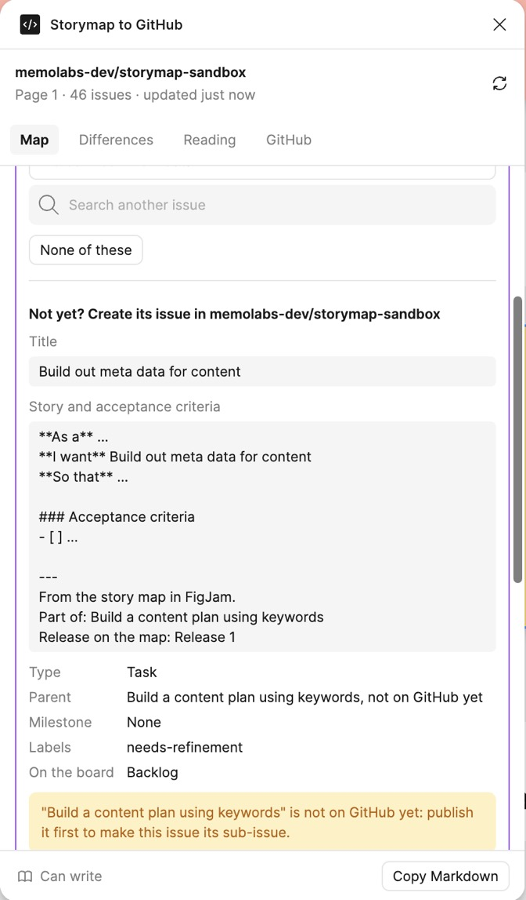

# Using Storymap to GitHub

The plugin sits next to your story map in FigJam. It reads the map, shows the GitHub backlog it is or will become, and lets you act on GitHub from the board. Nothing is written to GitHub until you click, and only where the team allowed it.

Installing it and connecting GitHub: see [install.md](install.md).

## The four tabs

- **Map**: the map as a backlog, and the card of the sticky you select.
- **Differences**: where the map and GitHub no longer agree, what moved this week, and the stickies with no issue yet.
- **Reading**: how the plugin reads your board.
- **GitHub**: your account, the repository, the project board, your role, and what the plugin may do.

The header names the connected repository, the page being read and when GitHub was last read. The round arrow reads the board and GitHub again.

## Getting started

A short guide sits at the top of the Map tab until each step is done: check how the board is read, connect GitHub, link a first sticky, show labels on the board. It shows one step at a time and goes away when all four are done. The cross hides it; the **Guide** button in the header brings it back.

## How the board is read

The plugin knows two ways teams lay out a story map, and picks one by itself:

- **By rows**, as in Figma's story map template. Each labelled row gives the kind of the stickies in it: User Persona becomes notes, Activities epics, Tasks features, and each Release row a milestone holding its tasks.
- **By colours**, as on many team boards. Each sticky colour gives one kind of item: by default yellow epics, blue features, green steps, violet tasks and pink notes.

The Reading tab shows what was found and lets you change it: force rows or colours, change what a row or a colour means. A section named `Legend`, and stickies that explain the colours, are skipped. A feature belongs to the nearest epic at or left of it, a task to the column it overlaps most. An arrow between two stickies sets the parent, whatever the column.

## The map

The tree shows epics, features with their steps, tasks and sub-tasks. Each line has a badge:

- `#19` in green: linked to issue 19.
- `#19?` in orange: issue 19 has a close title. Open the card to confirm or pick another.
- `New`: not on GitHub yet.

Hovering a line selects its sticky on the board; clicking it zooms there and opens its card. Above the tree: the counts, how many stickies are linked, and filters by release and by sprint.

**Labels on the board.** The Labels switch puts a small label in the corner of each linked sticky, such as `#19 · Sprint 1 · Ready`. Labels follow their sticky when it moves and change when the issue changes.

## A sticky's card

Click a sticky on the board, or a line in the tree, and its card opens at the top of the Map tab.

**Already on GitHub?** The card shows the three issues it most likely is, with the words they share, and a search box. Click one to link it. **None of these** marks the sticky as not on GitHub yet. A linked card shows the issue's status, sprint, size and who is on it, and **Not this issue** removes the link. Links are kept in the file, so the whole team sees the same ones.

**Not yet? Create its issue.** The card previews the issue before anything is written:

- **Title**, from the sticky, which you can change.
- **Story and acceptance criteria**: the issue text, prefilled from the repository's template (as a, I want, so that, acceptance criteria, then where the sticky sits on the map). Write the story here.
- **Type, parent, milestone, labels, status on the board.** The type is GitHub's issue type when the organization has it, or a label of that name. The parent is the sticky's epic or feature, if it is on GitHub already. The milestone comes from the release row.

**Create the issue** creates it, makes it a sub-issue of its parent, adds it to the project board with its starting status, and links the sticky.

**Size.** On a linked sticky, the Size row sets the issue's size on the project board, or clears it.

## Publishing a batch

In **Differences**, open **On the map only**: every sticky with no issue, each with a box to tick. Nothing is ticked at first. **Tick the new ones** ticks every sticky that looks like no existing issue; the ones marked `#19?` look like an issue that exists, so open their card and link them instead. **Create N issues** creates them parents first, so a new feature lands under its new epic, and a sub-task under its new task.

## Differences

When a linked sticky and its issue no longer agree, the Differences tab says how:

- **Title**: the issue was renamed, or the sticky was.
- **Milestone**: the task sits in another release row than its milestone.
- **Parent**: the issue sits under another parent than on the map.
- **Planned too late**: the issue's sprint ends after the due date of its release.
- **Dropped on GitHub**: the issue was closed as not planned, but the map still has it.

**Why?** reads the issue's history and says who changed what, and when.

Each difference offers its choices, and nothing changes until you pick one:

- **The map is right**: rename the issue, set its milestone, or move it under the parent on the map.
- **Rename the sticky**, for a title, when GitHub is right.
- **Keep both**: hide the difference for the whole team, until either side changes again.

The tab also lists close titles to confirm, the stickies with no issue, and the open issues that are not on the map.

## What moved this week

At the weekly, press **Start the week now** in Differences. The plugin keeps a snapshot of the issues in the file. From then on, the section lists the issues created, closed, reopened or changed, field by field: title, milestone, status, sprint, size, assignees. **Start a new week** moves the starting point.

GitHub's issue history does not record changes made on a project board, such as a status or a sprint, which is why the plugin compares against its own snapshot.

## Roles

In the GitHub tab, each person picks a role: **Product manager**, **Tech lead**, or **Everyone**. The plugin then only offers the changes of that role, and says who to ask for the others.

Who does what is a setting of the whole team, under **More settings**. By default the product manager creates issues and sets sizes, titles and milestones; the tech lead moves issues under a parent. Roles keep people from changing someone else's field by mistake; they are not a security boundary.

## More settings

Under **More settings** in the GitHub tab, for each repository:

- **Who does what**, for the whole team.
- **The label of a new issue**, `needs-refinement` by default, empty for none.
- **The status of a new issue** on the project board, `Backlog` by default.
- **The text of a new issue**, with `{title}`, `{parent}`, `{release}` and `{steps}` filled in.

## Good to know

- **GitHub's issue list can lag by about a minute.** An issue the plugin just created or changed shows at once; a change made on GitHub itself can take a minute to show after a refresh.
- **Copy Markdown**, at the bottom, copies the backlog as a checklist, to paste into an issue or a note.
- **Figma's free plan** allows one page per FigJam file, and three files.
