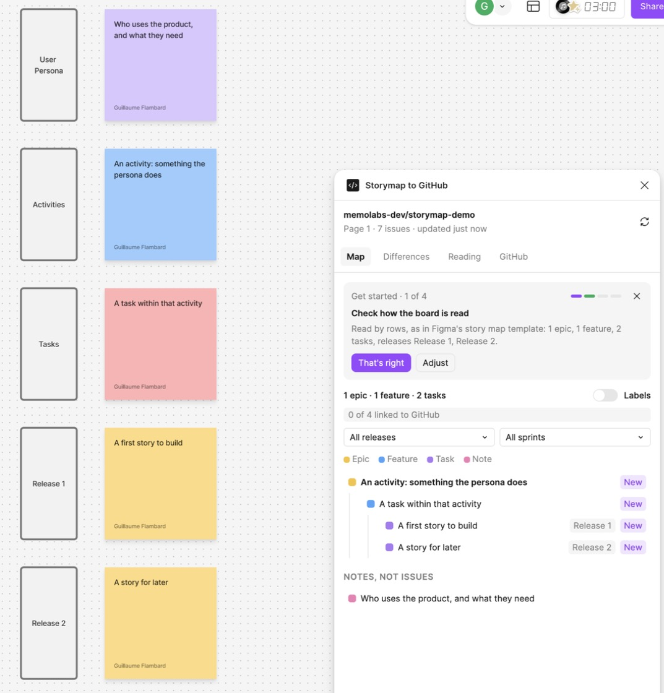
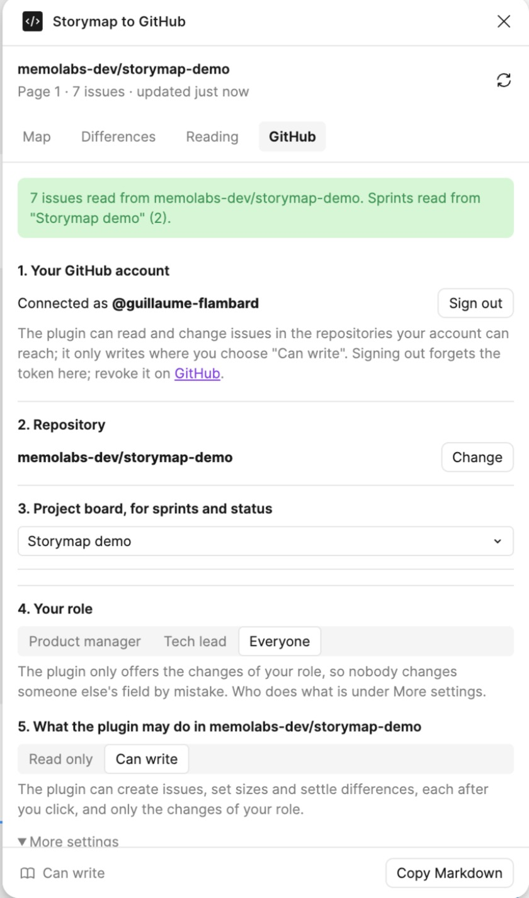

# Install Storymap to GitHub

Two parts: getting the plugin running for your team, then what the person who maintains it needs to know.

[Version française](fr/installation.md)

## For a team

### What you need

- The **Figma desktop app**. Development plugins do not run in the browser.
- **Edit access** to the FigJam file. Figma does not run plugins in view-only files.
- A **GitHub account** that can see the repository. To create issues from the plugin, it also needs write access to that repository.

### 1. Add the plugin to Figma

The plugin is not on Figma Community yet, so for now it is added as a development plugin, from its code. Each person who uses it does this once.

You need [Node.js 22](https://nodejs.org/) and access to this repository.

```bash
git clone https://github.com/memolabs-dev/storymap-to-github.git
cd storymap-to-github
npm install
npm run build
```

Then in the Figma desktop app, open any FigJam file and choose **Plugins › Development › Import plugin from manifest…**. Pick the `manifest.json` file that the build wrote at the root of the folder.

A development plugin only shows for the person who imported it. Once the plugin is published, this step goes away.

### 2. Open it on your story map

Open the page that holds your story map, then **Plugins › Development › Storymap to GitHub**. The quickest way: press `Cmd /`, type `Storymap`, press Enter.

The plugin speaks the language of your system, English or French. To change it: **GitHub** tab, **More settings**, **Language**.

On an empty page, the plugin offers **Add a story map template**: the rows of Figma's story map template (User Persona, Activities, Tasks, Release 1, Release 2), each with an example sticky.



### 3. Connect GitHub

In the **GitHub** tab:

1. **Connect with GitHub.** The plugin shows a short code. Press **Copy the code and open GitHub**, paste the code on the page that opens, and authorize **Storymap to GitHub**. The plugin is connected a few seconds later.
2. **Repository.** Pick it from the list of repositories your account can see. There is a search box.
3. **Project board.** Pick the GitHub Projects board that holds your sprints, sizes and statuses. If the repository has only one board, it is picked for you.
4. **Your role.** Product manager, tech lead, or everyone. The plugin then only offers the changes of your role.
5. **Read only or Can write.** Every repository starts in read only. Choose Can write when you want to create issues, set sizes or settle differences from the plugin.



**If your organization restricts OAuth apps**, GitHub asks an owner of the organization to approve Storymap to GitHub before the plugin can see its private repositories. The owner does it in the organization's settings, under **Third-party access**.

**Prefer a token?** Under Connect with GitHub, choose **Use a token instead** and paste a classic personal access token with the scopes `repo`, `project` and `read:org`.

### What is kept where

| What | Where | Who sees it |
|---|---|---|
| Your GitHub token, your role, your language | Figma's storage on your computer | You only |
| The repository and board of a file | Figma's storage on your computer, per file | You only |
| Links between stickies and issues, differences kept on purpose, the start of the week, who does what | Inside the FigJam file | Everyone on the board |

Signing out forgets the token on your computer. It stays valid on GitHub until you revoke it in [GitHub's application settings](https://github.com/settings/applications).

### Try it safely

Try it first on a copy of your board and a copy of your repository. `scripts/make-sandbox.mjs`, `finish-sandbox.mjs` and `check-sandbox.mjs` build a private copy of a real backlog (issues with the same numbers, milestones, labels, sub-issues, and a project board with the same statuses, sizes and sprints). They only read the source. Usage is in the [README](../README.md#try-it-on-a-copy).

## For the maintainer

### The sign-in relay

GitHub's sign-in endpoints for the device flow (`github.com/login/device/code` and `github.com/login/oauth/access_token`) send no CORS headers, so a Figma plugin cannot call them from its window. The relay in [`relay/`](../relay/index.js) is a Cloudflare Worker that forwards those two calls and adds the headers. It keeps nothing: no secret (the device flow needs none), no token, no log. The client id and the scopes are set in the relay, not by the caller.

It runs at `https://storymap-auth.storymap-authmemolabsworkersdev.workers.dev`. To deploy a change:

```bash
npx wrangler login
npx wrangler deploy --config relay/wrangler.jsonc
```

If the address changes, update `RELAY` in `src/main.ts` and `networkAccess.allowedDomains` in `package.json`, then rebuild.

### The GitHub OAuth App

**Storymap to GitHub** is an OAuth App of the `memolabs-dev` organization, with **Device Flow** turned on. Its client id is public and set in `relay/wrangler.jsonc`. It has no client secret, and none is needed.

### Develop

```bash
npm test        # the board reading logic and the relay, with Node's test runner
npm run watch   # rebuilds on every change; Figma reloads the plugin
npm run build   # typechecks and builds into build/
```

The plugin follows Create Figma Plugin's Preact template: `src/main.ts` runs in Figma, `src/ui.tsx` is the window. The logic that reads a board and compares it with GitHub is in `src/core.js`, without any Figma API, typed in `src/core.d.ts` and covered by `test/core.test.ts`.
